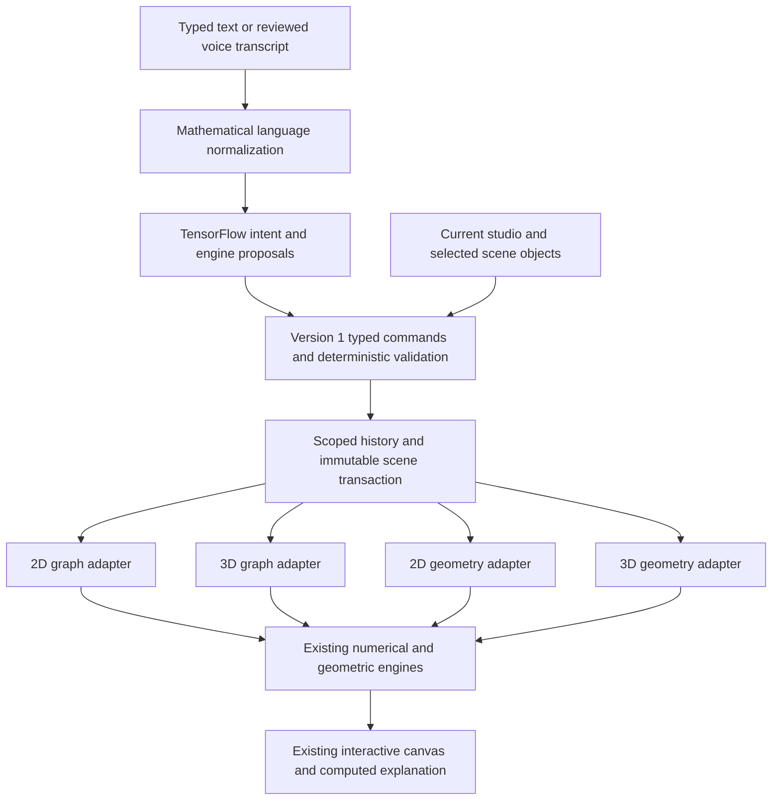

# Shared Ruhi architecture in the existing app

The direct request is to extend the current application's architecture, using the attached blueprints as reference. Existing UI, lessons, persistence and working mathematical engines remain in place. This increment does not implement the full 250-command product specification or redesign the app.

`RuhiStudioAssistant` is the shared transaction boundary. `RuhiCommand` carries schema version, engine, sealed operation, source modality, target, model proposals and routing reason. Existing graph actions are reused rather than duplicated. Geometry commands act on the existing control points, dependencies, shapes and solid models. Models do not supply numerical answers, formulas, meshes or pixels.

The intent model handles a narrow set of paraphrases through a validated canonical grammar. A second TensorFlow model proposes the studio, including contextual and out-of-domain categories. Current scene context and explicit studio requests take precedence where compatible; automatic cross-studio routing has strict confidence/margin gates. Unknown references and missing parameters require clarification.

Examples supported through the existing assistant prompt:

- `Ruhi, draw y equals x squared.` → `Make it red.` → `Shift it three units right.` → `Show the vertex.`
- `In 2D geometry, create point A at (2, 3).` → `Create point B at (6, 5).` → `Draw a line segment connecting A and B.` → `Find the midpoint of segment AB.`
- `In 2D geometry, create a square with side length four.` → `Calculate the area.` → `Scale it by 2.`
- `In 3D geometry, create a sphere with radius three.` → `Calculate the volume.`
- `Ruhi, create a rotating 3D cone.` → `Stop the rotation.` → `Undo.`
- `In 3D graph, plot z = x+y.`

Native 3D geometry retains its existing Y-up convention; 3D graphs retain Z-up. Animation derives rendered poses from angular velocity and elapsed monotonic time. It does not mutate history every frame. Touch editing freezes the displayed pose in one undoable transaction. Native deletion and Clear update the same reference/animation metadata.

State preparation occurs on a worker thread. A changed scene, selection or active-studio visibility rejects a stale commit. The scoped history command restores only fields changed by that operation, preserving the other studios. Existing workspace serialization round-trips the scene and command metadata. No new Room migration or microphone controls are required by this increment.

The 3D rendering path remains the app's current native Compose projection. A future Filament adapter can consume the same mesh/pose boundary. This increment does not claim GPU scene rendering or physical-GPU certification. LiteRT's Interpreter runs the actual TensorFlow-trained models on-device; [Google's runtime guidance](https://developers.google.com/edge/litert/migration) documents the compatible TensorFlow Lite path.

See [the recorded shared report](ruhi-shared-evidence/REPORT.md) for exact model performance, native canvas tests and limitations, and [the graph audit](ruhi-graph-evidence/REPORT.md) for the 150-command replay. The engine classifier's held-out accuracy is below the reference's 98% target; the report includes coverage and errors at the execution-confidence gate. No student conversation data is used for training.
