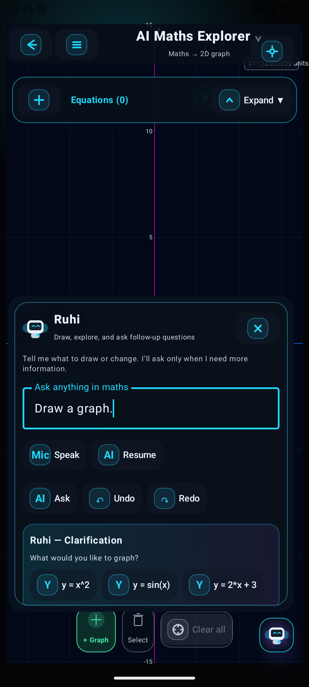
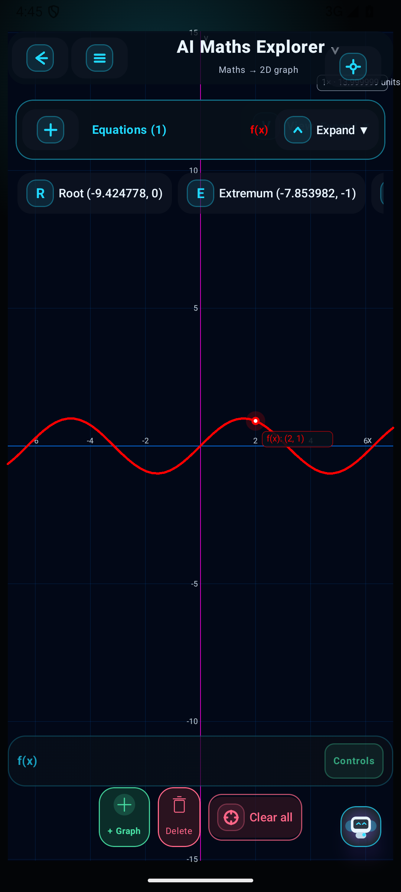

# Ruhi conversational follow-up engine

The existing four studios now share a bounded dialogue manager, pending slots, scene-ID resolution, default policies, actionable follow-up chips and persisted conversation memory. Lessons keep their original route. Mathematical engines remain deterministic.

## Recorded verification

- JVM methods: 73; failures/errors: 0.
- Real scene replay: 1100 conversations, 5350 turns; scene assertions passed: True. JVM rendering: NOT_RUN.
- Android instrumentation success summary: 8 methods passed.
- Visible incomplete command → clarification → clicked equation chip → native curve → conversational red style: PASS; changed central display-region pixels: 25851.
- Canvas gesture while chat remains open: True.
- Actual Android TensorFlow dialogue inference: PASS.

## Training and limits

- Additional authored multi-turn scenarios: 1100; unique labeled training-turn text: 533. They share templates and mathematical parameter families. No student conversations or correction records are used.
- Exported dialogue model: `349bc9a0be6ae034bba8b9f13bae4c33f3c38e4feea8cfa07ef4f6f45463ac34`.
- Small authored held-out phrase benchmark: 10/10; confidence gate accepts 7, accepted errors 0. This does not establish unrestricted NLP accuracy or statistical probability calibration.
- Binary English word/bigram model; deterministic grammar supplies mathematical entities and slots. Arbitrary constructions, tutoring dialogue, reference forms and multi-slot variants outside the reviewed grammar remain limited. Existing unsupported engine features remain unsupported.
- Android speech-recognition launcher is connected; raw microphone/audio recognition quality was not certified by these tests. Text and reviewed voice transcripts use the same dialogue path.
- Current solid references remain snapshot-bound indices; pending target edits require the scene fingerprint to match. Native rendering remains Compose CPU projection.
- The original 150-command state/mesh test is included in JVM regressions. A new complete 150-command screenshot audit is not claimed by this conversation-specific run.

## Evidence

See scenarios.jsonl, test-replay.tsv, scene-replay.json, model-evaluation.json, TEST XML files, build.log, device-run.log and source-manifest.json. The Android JSON is written only after scene, chip and pixel assertions pass.

Reproduce: train with scripts/train_ruhi_dialogue_nlp.py using scripts/ruhi-nlp-requirements.txt; run scripts/run_ruhi_dialogue_audit.ps1 with a connected emulator. See [architecture and defaults](../RUHI_CONVERSATION_ARCHITECTURE.md).
